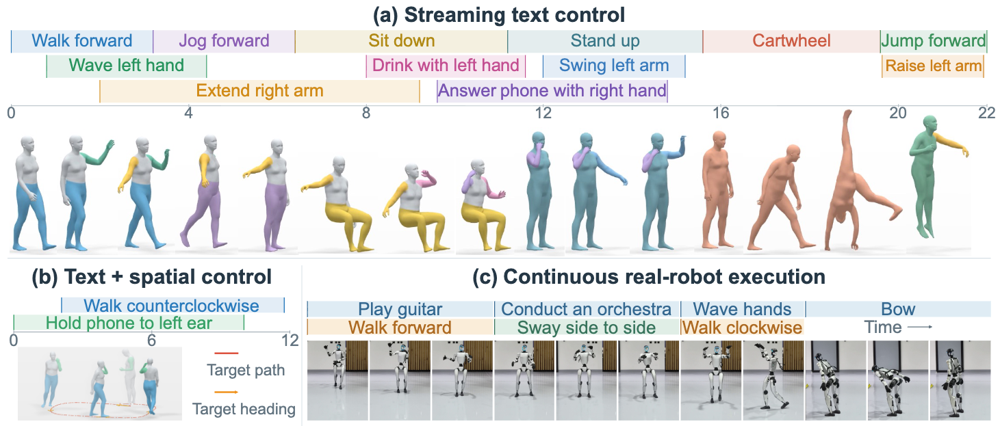

# (arXiv 2026) TimelineControl: Streaming Multi-Track Timeline Control for 3D Human Motion Generation
This is the official implementation for paper: "Streaming Multi-Track Timeline Control for 3D Human Motion Generation".


[[Project Page]](https://mael-zys.github.io/TimelineControl/) [[Paper]](https://arxiv.org/abs/2610.03873)




## Release Progress

- [ ] **Pretrained Models**: checkpoints for the causal TAE, Stage1 timeline generator, and Stage2 spatially conditioned generator.
- [ ] **Online Demo**: interactive 3D motion generation with timeline editing, body-part instructions, and playback controls.
- [ ] **TimelineMotion Dataset**: motion sequences with timeline captions, body-part annotations, and official train/validation/test splits.
- [ ] **Training and Evaluation Code**: scripts and configurations for all three models, including the paper's evaluation metrics.

The online demo and its required models will be released first, followed by the dataset and training/evaluation resources.


## Installation

*Coming soon.*

## Data and Pretrained Models

*Coming soon.*

## Interactive Demo

*Coming soon.*

## TAE

*Coming soon.*

## Stage1: Timeline Control

*Coming soon.*

## Stage2: Spatial Control

*Coming soon.*

## Citation
If you find our work or code useful for your research, please consider citing:

```
@article{zhang2026timelinecontrol,
  title     = {Streaming Multi-Track Timeline Control for 3D Human Motion Generation},
  author    = {Zhang, Yangsong and Muraleedharan, Anujith and Akizhanov, Rikhat and
               Varol, G{\"u}l and Pizzati, Fabio and Laptev, Ivan},
  journal   = {arXiv preprint},
  year      = {2026}
}
```

## Acknowledgements

We thank [ActionPlan](https://github.com/Coral79/ActionPlan-Code), [STMC](https://github.com/nv-tlabs/stmc), [TMR](https://github.com/Mathux/TMR), [MotionStreamer](https://github.com/zju3dv/MotionStreamer), [ARDY](https://github.com/nv-tlabs/ardy), [KIMODO](https://github.com/nv-tlabs/kimodo), and [SONIC](https://github.com/NVlabs/GR00T-WholeBodyControl) for their open-source contributions.
